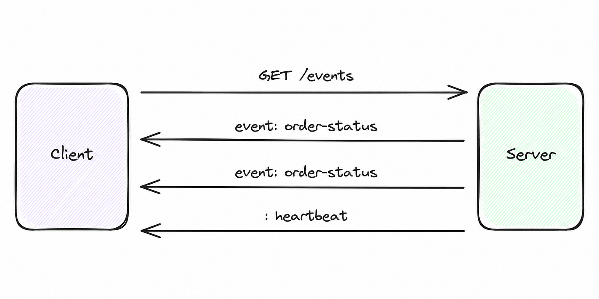
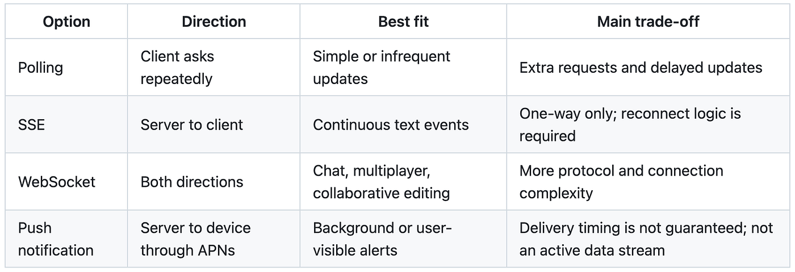
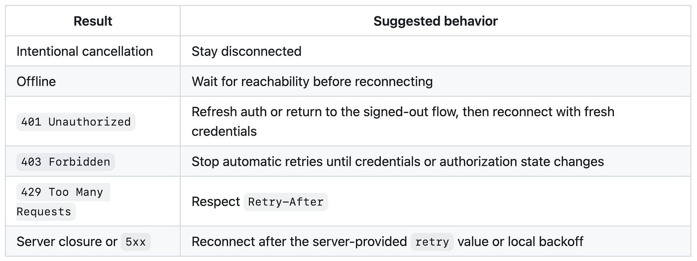

Most mobile apps start with a familiar pattern: send a request, receive a response, and close the connection. That works until the server knows something has changed before the user does.

Imagine an order-tracking screen. An order moves from `PROCESSING` to `SHIPPED` while the screen is open. Polling can catch the change, but it adds requests and leaves a delay before the next check.

**Server-Sent Events (SSE)** lets the server send that update over an existing HTTP connection. In this article, we will explore the wire format and walk through an iOS implementation using Swift, Alamofire, and RxSwift. The examples adapt a production architecture to a generic order-status flow.

> These snippets are focused extracts, not a complete networking library. Authentication, request signing, and the backend contract need to be supplied by your application.

## What is SSE?

SSE is a standard for keeping an HTTP response open so a server can send text events to a client over time. The client opens one connection; the server sends updates whenever information becomes available.

<figure class="article-figure">



  <figcaption>One request opens a stream of server-to-client updates.</figcaption>
</figure>

The response uses the `text/event-stream` media type. An event can look like this:

```text
event: order-status
id: evt-1042
retry: 5000
data: {"orderId":"ORD-123","status":"SHIPPED"}

```

The blank line ends the event. The fields have specific roles:

- `event` names the event, such as `order-status`.
- `data` carries the payload. Multiple `data` lines are joined with newlines.
- `id` identifies an event and can support resuming after a disconnect.
- `retry` suggests a reconnect delay in milliseconds.
- A line beginning with `:` is a comment, often used as a heartbeat.

SSE carries UTF-8 text over HTTP. Updates travel from the server to the client; it does not provide a two-way socket.

## How SSE works

1. The client sends a `GET` request accepting `text/event-stream`.
2. The server returns a successful response and leaves it open.
3. The server writes event blocks as updates occur.
4. The client handles each complete event while the response is still running.
5. If the connection closes unexpectedly, the client applies its reconnect policy.

A request might contain these headers:

```http
GET /api/v1/orders/events HTTP/1.1
Accept: text/event-stream
Cache-Control: no-cache
Authorization: Bearer <access-token>
```

The server can continue sending events:

```text
event: order-status
data: {"orderId":"ORD-123","status":"PACKED"}

event: order-status
data: {"orderId":"ORD-123","status":"SHIPPED"}

```

The detail that matters most when implementing the client is that **network chunks are not messages**. A `URLSession` or Alamofire callback can contain half a line, multiple events, or bytes that split a UTF-8 character.

For example, one event may arrive in three chunks:

```text
Chunk 1: event: order-st
Chunk 2: atus\ndata: {"orderId":"ORD-
Chunk 3: 123","status":"SHIPPED"}\n\n
```

Buffer incoming bytes and parse complete lines and event blocks. Decoding each callback as a JSON object will eventually fail.

## When should we use SSE?

SSE fits updates that mostly travel from the server to the app:

- Order and delivery status
- Queue positions and appointment updates
- Progress for long-running server jobs
- Dashboards and live metrics
- Notification feeds while the app is open
- Moderation and approval status

<figure class="article-figure">



  <figcaption>Choose the transport based on the direction and timing of updates.</figcaption>
</figure>

Polling is simple for infrequent updates, but adds requests and delay. SSE supports continuous server-to-client text events and needs reconnect logic. WebSocket supports frequent communication in both directions, with more connection and protocol complexity. APNs fits background notifications and user-visible alerts, rather than an active data stream.

## Designing the iOS architecture

Separate the connection from parsing, lifecycle management, and screen updates:

```text
Scene lifecycle
      |
      v
SSE coordinator ---- reachability / auth changes / retry policy
      |
      v
SSE client --------- HTTP connection and raw byte stream
      |
      v
Message parser ----- event, data, retry, heartbeat handling
      |
      v
Visible screen ----- filters signals and refreshes authoritative data
```

The parser knows nothing about HTTP or UIKit. The client owns one streaming request. The coordinator manages lifecycle and reconnection. Each screen reacts only to events that affect the resource it displays.

Here, Alamofire supplies `DataStreamRequest`, and RxSwift publishes events to screens. The same separation works with `URLSessionDataDelegate` and Combine or `AsyncStream`.

## Step 1: Model the event

Use a typed payload rather than passing dictionaries through the app:

```swift
import Foundation

enum OrderStatus: String, Decodable {
    case processing = "PROCESSING"
    case packed = "PACKED"
    case shipped = "SHIPPED"
    case delivered = "DELIVERED"
    case cancelled = "CANCELLED"
}

struct OrderStatusEvent: Decodable {
    let orderId: String
    let status: OrderStatus
    let updatedAt: Date
}
```

Configure `JSONDecoder` for the backend date format. The shorter wire-format examples above omit `updatedAt` to focus on framing; payloads decoded into this model must include it.

## Step 2: Parse the stream incrementally

The parser holds unfinished bytes between callbacks. A line-feed byte completes a line; a blank line completes an event block.

```swift
import Foundation

struct SSEMessage {
    let event: String
    let data: String
    let retryMilliseconds: Int?
}

final class SSEMessageParser {
    private var bufferedData = Data()
    private var eventName: String?
    private var dataLines: [String] = []
    private var retryMilliseconds: Int?

    func append(_ data: Data) -> [SSEMessage] {
        bufferedData.append(data)
        var messages: [SSEMessage] = []

        while let newlineIndex = bufferedData.firstIndex(of: 0x0A) {
            let lineData = bufferedData[..<newlineIndex]
            bufferedData.removeSubrange(...newlineIndex)
            var line = String(decoding: lineData, as: UTF8.self)

            if line.last == "\r" {
                line.removeLast()
            }

            if line.isEmpty {
                if let message = finishMessage() {
                    messages.append(message)
                }
                continue
            }

            // SSE comments are commonly used as heartbeats.
            guard !line.hasPrefix(":") else { continue }

            let parts = line.split(
                separator: ":",
                maxSplits: 1,
                omittingEmptySubsequences: false
            )
            let field = String(parts[0])
            var value = parts.count > 1 ? String(parts[1]) : ""

            if value.first == " " {
                value.removeFirst()
            }

            switch field {
            case "event":
                eventName = value
            case "data":
                dataLines.append(value)
            case "retry":
                retryMilliseconds = Int(value)
            default:
                break
            }
        }

        return messages
    }

    func reset() {
        bufferedData.removeAll(keepingCapacity: false)
        eventName = nil
        dataLines.removeAll(keepingCapacity: false)
        retryMilliseconds = nil
    }

    private func finishMessage() -> SSEMessage? {
        defer {
            eventName = nil
            dataLines.removeAll(keepingCapacity: true)
            retryMilliseconds = nil
        }

        guard eventName != nil ||
              !dataLines.isEmpty ||
              retryMilliseconds != nil else {
            return nil
        }

        return SSEMessage(
            event: eventName ?? "message",
            data: dataLines.joined(separator: "\n"),
            retryMilliseconds: retryMilliseconds
        )
    }
}
```

Buffering `Data` protects a UTF-8 sequence split across network chunks. Convert to `String` after receiving a complete line.

This compact example handles `LF` and `CRLF`. It is a limited parser: support bare `CR` if your server emits it, and add explicit `id` handling if the backend requires event resumption. Set buffer limits before using it with unbounded input.

## Step 3: Open a streaming request

The client owns the HTTP connection. Alamofire calls `responseStream` repeatedly as bytes arrive:

```swift
import Alamofire
import Foundation

final class SSEClient {
    struct Completion {
        let statusCode: Int?
        let retryAfter: TimeInterval?
        let error: Error?
        let wasCancelled: Bool
    }

    var onOpen: (() -> Void)?
    var onMessage: ((SSEMessage) -> Void)?
    var onCompletion: ((Completion) -> Void)?

    private let session: Session
    private let parser = SSEMessageParser()
    private var request: DataStreamRequest?
    private var intentionallyCancelled = false
    private var didOpen = false

    init(session: Session = .default) {
        self.session = session
    }

    func connect(url: URL, bearerToken: String?) {
        cancel(notify: false)
        parser.reset()
        intentionallyCancelled = false
        didOpen = false

        var urlRequest = URLRequest(url: url)
        urlRequest.httpMethod = "GET"
        urlRequest.timeoutInterval = 60 * 60
        urlRequest.setValue("text/event-stream", forHTTPHeaderField: "Accept")
        urlRequest.setValue("no-cache", forHTTPHeaderField: "Cache-Control")

        if let bearerToken, !bearerToken.isEmpty {
            urlRequest.setValue(
                "Bearer \(bearerToken)",
                forHTTPHeaderField: "Authorization"
            )
        }

        let streamRequest = session.streamRequest(urlRequest)
        request = streamRequest

        streamRequest.onHTTPResponse(on: .main) { [weak self] response in
            guard let self,
                  (200...299).contains(response.statusCode),
                  !self.didOpen else { return }
            self.didOpen = true
            self.onOpen?()
        }

        streamRequest.responseStream(on: .main) { [weak self] stream in
            guard let self else { return }

            switch stream.event {
            case .stream(let result):
                guard case .success(let data) = result else { return }
                self.parser.append(data).forEach { self.onMessage?($0) }

            case .complete(let completion):
                let response = completion.response
                let retryAfter = response?
                    .value(forHTTPHeaderField: "Retry-After")
                    .flatMap(Self.retryAfterInterval)
                let wasCancelled = self.intentionallyCancelled ||
                    completion.error?.isExplicitlyCancelledError == true

                self.request = nil
                self.onCompletion?(
                    Completion(
                        statusCode: response?.statusCode,
                        retryAfter: retryAfter,
                        error: completion.error,
                        wasCancelled: wasCancelled
                    )
                )
            }
        }
    }

    func cancel() {
        cancel(notify: true)
    }

    private func cancel(notify: Bool) {
        intentionallyCancelled = true
        let activeRequest = request
        request = nil
        activeRequest?.cancel()
        parser.reset()

        if notify, activeRequest == nil {
            onCompletion?(
                Completion(
                    statusCode: nil,
                    retryAfter: nil,
                    error: nil,
                    wasCancelled: true
                )
            )
        }
    }

    private static func retryAfterInterval(_ rawValue: String) -> TimeInterval? {
        if let seconds = TimeInterval(rawValue) {
            return max(seconds, 0)
        }

        let formatter = DateFormatter()
        formatter.locale = Locale(identifier: "en_US_POSIX")
        formatter.timeZone = TimeZone(secondsFromGMT: 0)
        formatter.dateFormat = "EEE',' dd MMM yyyy HH':'mm':'ss z"

        return formatter.date(from: rawValue).map {
            max($0.timeIntervalSinceNow, 0)
        }
    }
}
```

Use your application's secured `Session` when it provides signing, certificate handling, or other interceptors. Recreate requests on reconnect so access tokens, timestamps, and nonces are fresh.

Keep intentional cancellation separate from network failure. Navigating away or backgrounding the app should not start a reconnect loop. These extracts also need connection ownership checks when replacing an active request, so callbacks from an older stream cannot modify a newer connection's state.

## Step 4: Decode only the events we understand

Heartbeats, unfamiliar event names, and malformed JSON should not tear down an otherwise healthy stream. These methods belong in the coordinator that owns `retryDelay` and `eventSubject`:

```swift
private let decoder: JSONDecoder = {
    let decoder = JSONDecoder()
    decoder.dateDecodingStrategy = .iso8601
    return decoder
}()

private func handle(_ message: SSEMessage) {
    if let retry = message.retryMilliseconds, retry > 0 {
        retryDelay = TimeInterval(retry) / 1_000
    }

    switch message.event {
    case "heartbeat":
        return

    case "order-status":
        do {
            let event = try decoder.decode(
                OrderStatusEvent.self,
                from: Data(message.data.utf8)
            )
            eventSubject.onNext(event)
        } catch {
            NSLog("Invalid order-status SSE payload: %@", error.localizedDescription)
        }

    default:
        // Forward compatibility: ignore event types from newer servers.
        return
    }
}
```

The `default` branch keeps newer server event types from breaking older clients. Log decoding failures carefully: production payloads may contain user details or tokens.

## Step 5: Let a coordinator own lifecycle and reconnection

If each view controller opens a stream, navigation can create duplicate connections and refreshes. A shared coordinator keeps one connection while at least one scene is active:

```swift
import RxSwift

enum SSEConnectionState: Equatable {
    case disconnected
    case connecting
    case connected
    case reconnecting
}

final class OrderStatusSSECoordinator {
    static let shared = OrderStatusSSECoordinator()

    var events: Observable<OrderStatusEvent> {
        eventSubject.asObservable()
    }

    var connectionStates: Observable<SSEConnectionState> {
        connectionStateSubject.distinctUntilChanged()
    }

    private let eventSubject = PublishSubject<OrderStatusEvent>()
    private let connectionStateSubject =
        BehaviorSubject<SSEConnectionState>(value: .disconnected)
    private var activeSceneIDs: Set<String> = []
    private var client: SSEClient?
    private var reconnectTask: DispatchWorkItem?
    private var retryDelay: TimeInterval = 5
    private var isNetworkConnected = true
    private var reconnectBlocked = false

    private init() {}

    func enterForeground(sceneID: String) {
        dispatchPrecondition(condition: .onQueue(.main))
        let wasInactive = activeSceneIDs.isEmpty
        activeSceneIDs.insert(sceneID)
        guard wasInactive else { return }
        reconnectBlocked = false
        connectIfNeeded(isReconnect: false)
    }

    func enterBackground(sceneID: String) {
        dispatchPrecondition(condition: .onQueue(.main))
        activeSceneIDs.remove(sceneID)
        guard activeSceneIDs.isEmpty else { return }
        reconnectTask?.cancel()
        reconnectTask = nil
        client?.cancel()
        client = nil
        connectionStateSubject.onNext(.disconnected)
    }
}
```

This is the lifecycle portion of the coordinator. Your application supplies `connectIfNeeded`, endpoint and credential providers, callback wiring, and completion handling.

Use a set of scene identifiers because an iPad app can have multiple scenes. Deactivating one scene should not stop a connection another scene still needs.

Connect it to UIKit's scene lifecycle:

```swift
func sceneDidBecomeActive(_ scene: UIScene) {
    OrderStatusSSECoordinator.shared.enterForeground(
        sceneID: scene.session.persistentIdentifier
    )
}

func sceneDidEnterBackground(_ scene: UIScene) {
    OrderStatusSSECoordinator.shared.enterBackground(
        sceneID: scene.session.persistentIdentifier
    )
}

func sceneDidDisconnect(_ scene: UIScene) {
    OrderStatusSSECoordinator.shared.enterBackground(
        sceneID: scene.session.persistentIdentifier
    )
}
```

The coordinator also needs to respond to connectivity and authentication:

- Cancel pending reconnect work when the network disconnects.
- Reconnect when connectivity returns and a scene is active.
- Cancel the old stream after login, logout, or token refresh, then use current credentials.
- Keep mutable coordinator state on one serial context, here the main queue.

### A practical reconnect policy

Retrying every error can drain the battery or repeatedly send invalid credentials. Choose the response based on the reason the stream ended:

<figure class="article-figure">



  <figcaption>The reconnect decision depends on cancellation, connectivity, and HTTP status.</figcaption>
</figure>

Intentional cancellation stays disconnected. Offline clients wait for connectivity. A `401` needs refreshed authentication or the signed-out flow; a `403` blocks automatic retries until authorization changes. Respect `Retry-After` for a `429`. For server closure or `5xx`, use the server's retry delay or local backoff.

Allow only one scheduled reconnect:

```swift
private func scheduleReconnect(after delay: TimeInterval) {
    guard !activeSceneIDs.isEmpty,
          isNetworkConnected,
          !reconnectBlocked,
          reconnectTask == nil else {
        return
    }

    connectionStateSubject.onNext(.reconnecting)

    let task = DispatchWorkItem { [weak self] in
        guard let self else { return }
        self.reconnectTask = nil
        self.connectIfNeeded(isReconnect: true)
    }

    reconnectTask = task
    DispatchQueue.main.asyncAfter(
        deadline: .now() + max(delay, 0),
        execute: task
    )
}
```

For large deployments, exponential backoff with jitter spreads reconnects after an outage. Follow server-provided `retry` and `Retry-After` values according to your backend contract.

## Step 6: Use SSE to signal a data refresh

For transactional screens, an event can mean that a resource changed. Fetch the complete, authoritative state through the existing REST endpoint:

```text
SSE says order ORD-123 changed
              |
              v
GET /orders/ORD-123
              |
              v
Render the complete, validated order response
```

This keeps stream payloads small and reuses response mapping and business validation. An authoritative fetch also helps recover from missed events and avoids treating a lightweight signal as the final source for prices, permissions, or inventory.

A live metric may render directly from SSE. Choose the approach based on what the screen needs to trust.

## Step 7: Avoid refresh storms

A timer, an SSE event, and a replay after reconnect can all refer to the same order. Starting a request for every signal wastes work and can let responses arrive out of order.

A refresh gate combines bursts with a short debounce and allows only one refresh per resource at a time:

```swift
final class RefreshGate<Key: Hashable> {
    typealias RefreshAction = (@escaping () -> Void) -> Void

    private struct State {
        var debounceTask: DispatchWorkItem?
        var pendingAction: RefreshAction?
        var isRefreshing = false
    }

    private let debounceInterval: TimeInterval
    private var states: [Key: State] = [:]

    init(debounceInterval: TimeInterval = 0.5) {
        self.debounceInterval = debounceInterval
    }

    func submit(key: Key, action: @escaping RefreshAction) {
        var state = states[key] ?? State()
        state.pendingAction = action

        guard !state.isRefreshing else {
            states[key] = state
            return
        }

        state.debounceTask?.cancel()
        let task = DispatchWorkItem { [weak self] in
            self?.startPendingRefresh(for: key)
        }
        state.debounceTask = task
        states[key] = state

        DispatchQueue.main.asyncAfter(
            deadline: .now() + debounceInterval,
            execute: task
        )
    }

    private func startPendingRefresh(for key: Key) {
        guard var state = states[key],
              !state.isRefreshing,
              let action = state.pendingAction else {
            return
        }

        state.debounceTask = nil
        state.pendingAction = nil
        state.isRefreshing = true
        states[key] = state

        action { [weak self] in
            DispatchQueue.main.async {
                self?.finishRefresh(for: key)
            }
        }
    }

    private func finishRefresh(for key: Key) {
        guard var state = states[key] else { return }
        state.isRefreshing = false

        guard state.pendingAction != nil else {
            states[key] = nil
            return
        }

        states[key] = state
        startPendingRefresh(for: key)
    }
}
```

Key the gate by resource so updates for different orders stay independent. Call `submit` on the main queue, matching the gate's scheduled work. Every refresh must call its completion on both success and failure, otherwise one failed request can leave the gate locked.

## Step 8: Subscribe while the screen can use the event

Filter by resource and check visibility before refreshing:

```swift
final class OrderDetailViewController: UIViewController {
    private let disposeBag = DisposeBag()
    private let refreshGate = RefreshGate<String>()
    private let orderId: String

    private func observeOrderEvents() {
        OrderStatusSSECoordinator.shared.events
            .observe(on: MainScheduler.instance)
            .filter { [orderId] event in
                event.orderId == orderId
            }
            .subscribe(onNext: { [weak self] event in
                guard let self,
                      self.isViewLoaded,
                      self.view.window != nil,
                      self.presentedViewController == nil else {
                    return
                }

                self.refreshGate.submit(key: event.orderId) { completion in
                    self.reloadOrder(completion: completion)
                }
            })
            .disposed(by: disposeBag)
    }
}
```

Your view controller supplies its initializer, `orderId`, and `reloadOrder`. `[weak self]` prevents the subscription from retaining the screen; `MainScheduler` keeps UIKit work on the main thread.

If the screen can switch resources or filters, use a request identifier or generation counter so an older REST response cannot overwrite newer state.

## Production details that deserve attention

### Heartbeats and proxy buffering

Idle connections may be closed by load balancers, mobile networks, or proxies. Have the server send comments such as `: heartbeat` and flush its response. Proxy buffering can otherwise turn live updates into delayed batches.

### Event resumption

The format supports `id`; browser `EventSource` clients can send `Last-Event-ID` on reconnect. A custom iOS client must parse, store, and resend that value explicitly when the backend requires replay.

If reconnecting always triggers an authoritative REST fetch, you may deliberately omit event-ID persistence. Make that choice part of the contract.

### Duplicate and out-of-order events

Expect duplicate, delayed, or stale events. Event IDs, server versions, timestamps, or an authoritative refetch can make handling idempotent.

### Authentication changes

An active request keeps the headers it had when it was created. Cancel and recreate the connection after credentials change.

### App backgrounding

Cancel the stream when no scene is active and reconnect when the app returns. A foreground SSE request should not be assumed to run indefinitely in the background. Use APNs for background user notifications.

### Timeouts

A long request timeout does not guarantee a permanent connection. The server, OS, proxy, or network can still close it. Reconnection is part of normal operation.

### Memory and privacy

Discard consumed bytes and limit unfinished buffers. A malformed stream that never sends a delimiter must not grow memory indefinitely. Keep personal and transactional payloads out of logs.

## What I would verify before shipping

- A complete event arriving in one chunk
- One event split across chunks, including a UTF-8 character boundary
- Multiple events in a single chunk
- Multiple `data` lines in one event
- Heartbeats and unknown event names
- Malformed JSON followed by a valid event
- Server `retry` values
- Numeric and HTTP-date `Retry-After` headers
- Network loss and recovery
- Foreground, background, and scene disconnection
- Login, logout, token expiry, `401`, `403`, `429`, and `5xx`
- Duplicate events for one resource
- Events for different resources arriving together
- Navigating away during a refresh
- A failed refresh followed by a successful retry

Track connection duration, reconnect reasons, HTTP status, retry delays, parsing failures, and event-to-UI latency without recording sensitive payloads.

## Closing thoughts

Opening an SSE connection is a small part of the work. Reliability comes from parsing bytes incrementally, reconnecting according to the cause, respecting the app lifecycle, and preventing duplicate or stale refreshes from reaching the UI.

Keep one lifecycle-aware stream, use events to invalidate authoritative data when appropriate, and serialize refreshes per resource. For one-way live updates, that gives an iOS app timely updates with a manageable networking model.

## References

- [Original article on Medium](https://medium.com/@prammmoe/getting-to-know-server-sent-events-and-actually-implementing-it-on-ios-a5cd22b1daf8)
- [MDN: Using server-sent events](https://developer.mozilla.org/en-US/docs/Web/API/Server-sent_events/Using_server-sent_events)
- [WHATWG HTML Standard: Server-sent events](https://html.spec.whatwg.org/dev/server-sent-events.html)
- [Apple: Receiving incremental URL session data](https://developer.apple.com/documentation/foundation/urlsessiondatadelegate/urlsession(_:datatask:didreceive:))
- [Alamofire: DataStreamRequest](https://alamofire.github.io/Alamofire/Classes/DataStreamRequest.html)
