## Context and responsibilities

Since March 2026, I have worked as an iOS Developer at Arya Noble, developing and maintaining ERHA Buddy within a **two-person iOS team**. The app serves approximately **40,000 monthly active users**, as reported in this portfolio.

My responsibilities include feature implementation, technical design, sprint planning, estimation, code reviews, release preparation, and post-release monitoring.

## Registration simplification: shopping before signing in

I reworked the shopping journey so users could browse products and treatments, build a guest cart, select an address, and review their order before authentication became necessary at checkout.

This required more than moving the login screen. I implemented guest-state persistence, cart and address synchronization after login, context-aware authentication gates, and post-login revalidation of prices and promotions.

I also simplified registration through centralized validation, normalized phone-number handling, and optional KTP scanning and autofill. Post-release analytics showed a **98.1% quarter-over-quarter increase in average daily cart checkout intent**, an outcome the revised journey contributed to.

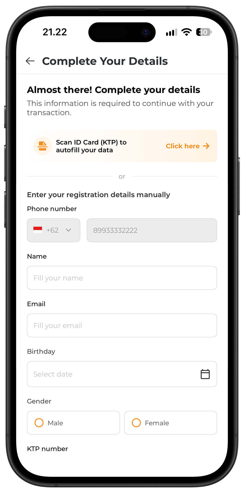

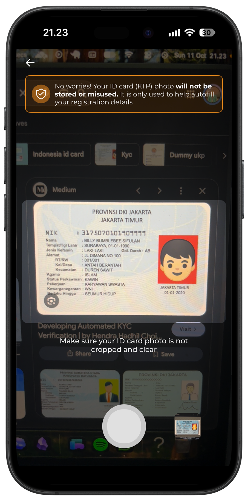

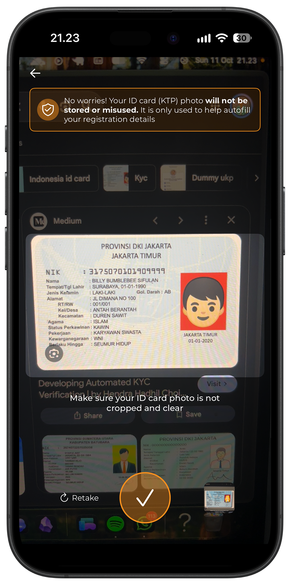

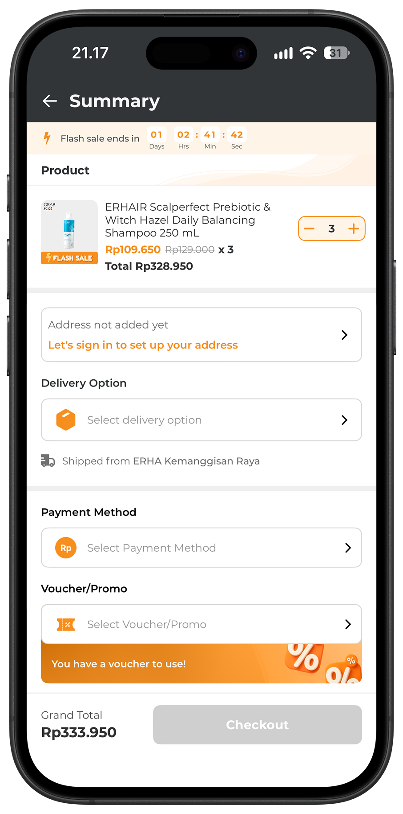

## Flash Sale: implementing the purchase journey

I implemented the iOS Flash Sale journey across Home, campaign catalogs, product and treatment details, cart, order summary, checkout, and transaction details.

The implementation covered Internal and External Flash Sale flows, including their different cart and fulfillment requirements. I handled campaign countdowns, promotional pricing, stock-aware quantity limits, clinic selection, and campaign availability changes.

A substantial part of the work involved keeping these rules consistent across screens, especially when a campaign changed state or the server adjusted availability during an active shopping session.

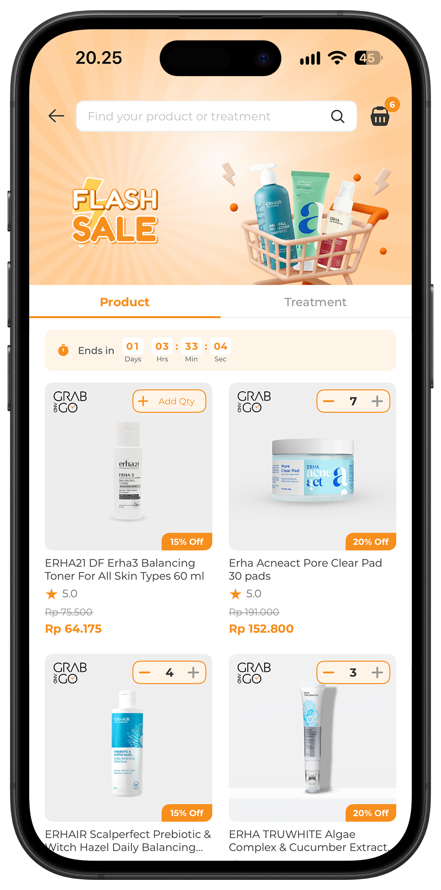

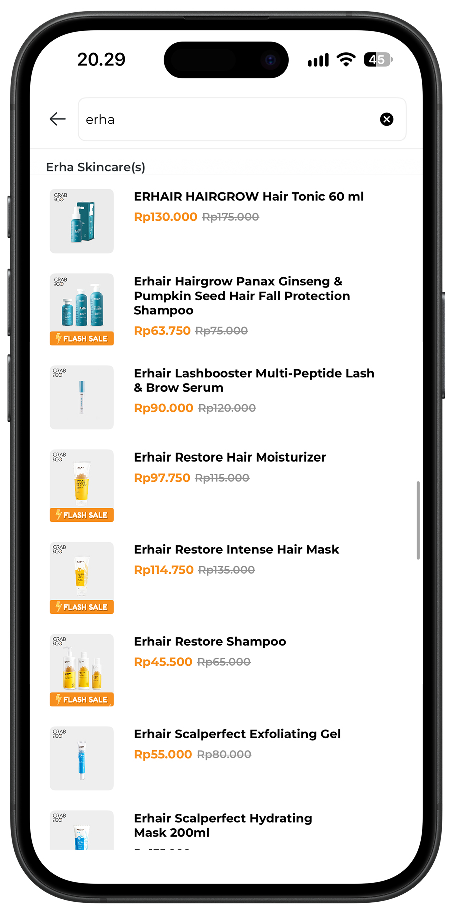

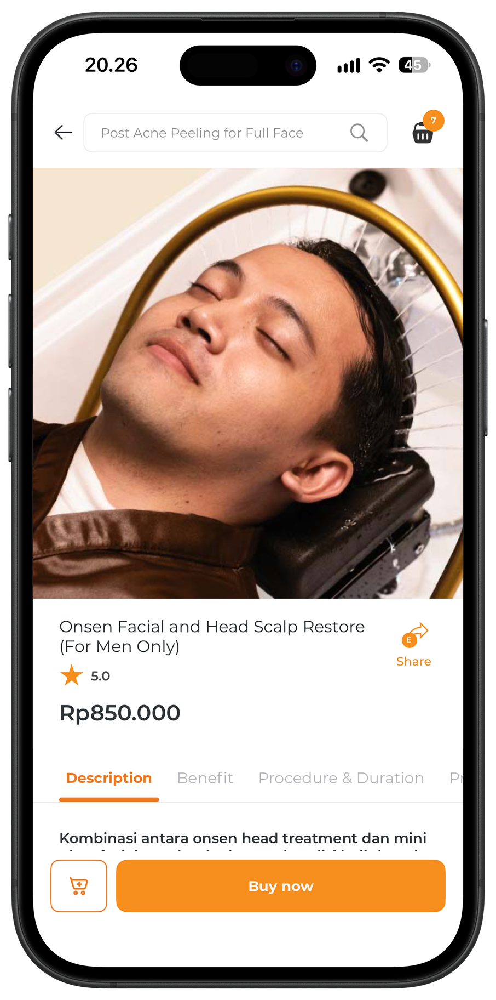

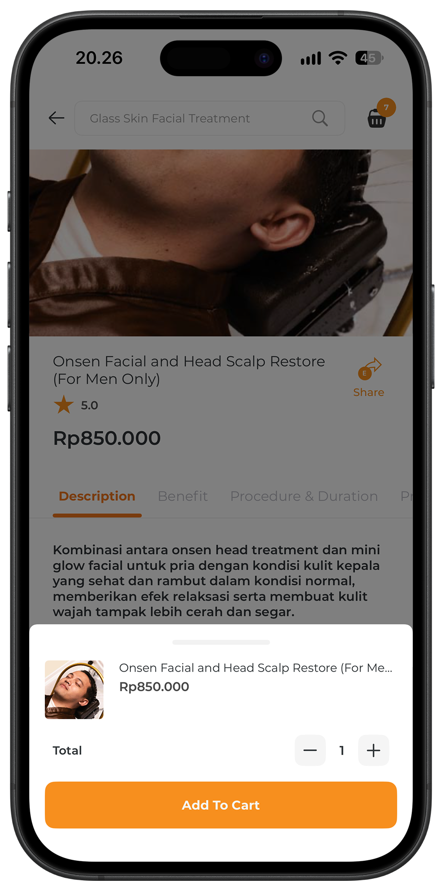

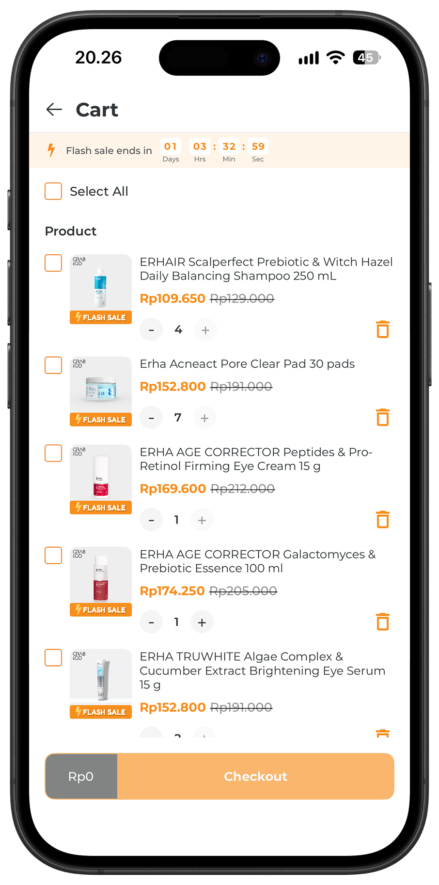

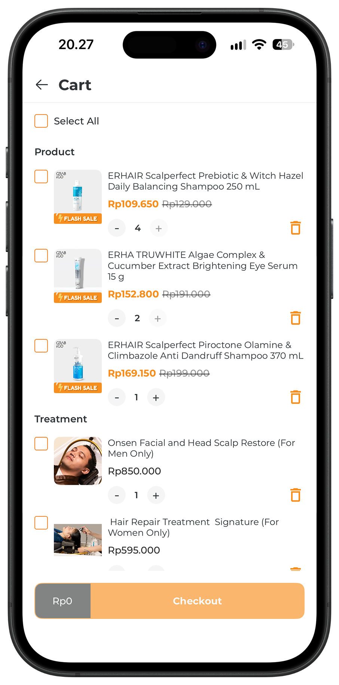

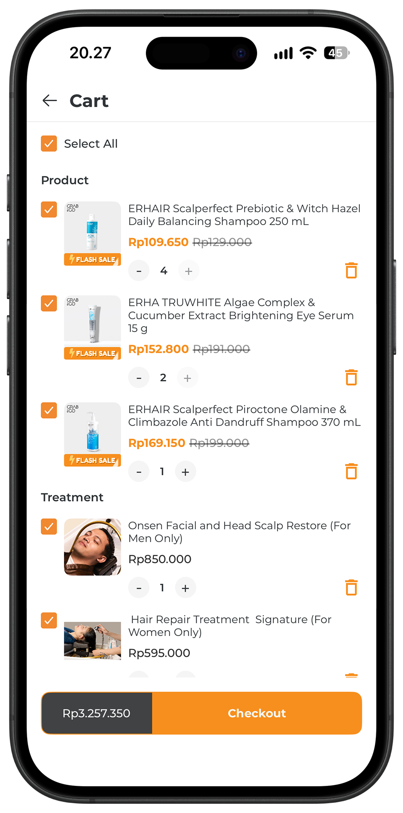

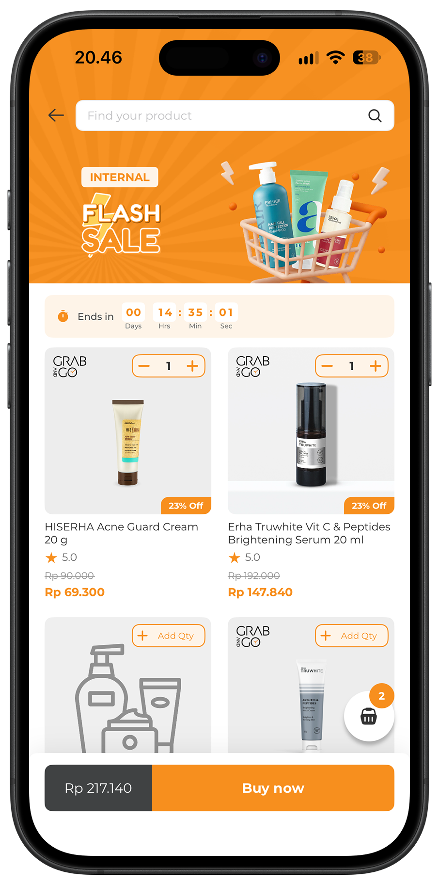

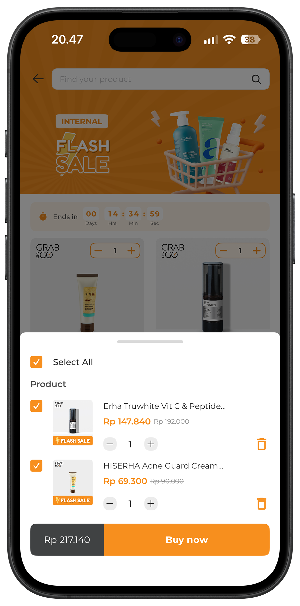

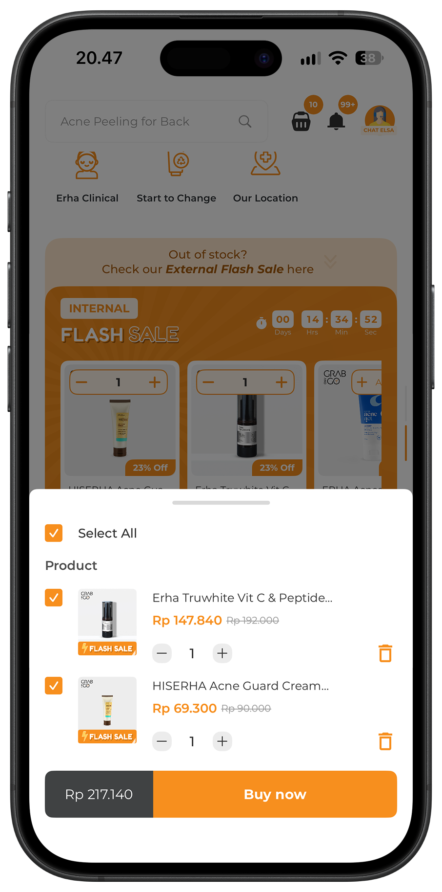

## SSE: keeping Flash Sale screens updated

I implemented an application-wide Server-Sent Events connection to receive Flash Sale lifecycle updates and refresh affected screens.

The client handles incremental event parsing, heartbeats, retry instructions, network recovery, authentication changes, and foreground/background transitions. I also added reconnect behavior and a local deadline fallback for upcoming campaigns.

Events trigger REST refreshes, while REST responses remain authoritative for prices, stock, eligibility, and checkout state. Refresh coordination reduces overlapping requests and keeps Home, catalogs, product details, cart, and order summary aligned as campaign conditions change.

Read the [complete example implementation](/blog/getting-to-know-server-sent-events-on-ios/), also published [on Medium](https://medium.com/@prammmoe/getting-to-know-server-sent-events-and-actually-implementing-it-on-ios-a5cd22b1daf8).

## HMAC: agreeing on each request

I designed and implemented HMAC request signing on the iOS side, aligned with the backend verification contract. Signing covers canonical request paths, query parameters, payloads, nonces, and timestamps, with the required signature headers attached through the shared networking layer.

Centralizing this behavior made request protection consistent across API callers and reduced duplicated signing logic. The work also required handling URL encoding and serialized payloads correctly, so the client and server could verify the same request representation, and restricting internal integrity headers when requests reached external hosts.

Read the [complete HMAC implementation](/blog/securing-api-requests-with-hmac-in-swift/).

## App Attest: handling verification failures

I implemented the iOS Apple App Attest integration, including backend challenge retrieval, device-key registration, Keychain persistence, and per-request assertions.

I handled failure paths such as invalid or unknown keys, failed native assertions, and backend-rejected proofs, with bounded recovery and retry behavior. Registration is coordinated so concurrent requests do not independently create competing keys. The rollout also accounted for app-version compatibility and simulator limitations.

Recovery distinguishes safe requests from mutating operations, avoiding automatic repetition of business actions when the server provides no idempotency guarantee.

## Calculate Order: removing redundant requests

I optimized the Calculate Order flow by changing when calculations are triggered and coordinating requests with equivalent inputs.

The summary can display preliminary fees before a payment method is selected, reuse a valid quote, or join an equivalent request already in progress. Changes that affect pricing invalidate the relevant quote, while stale responses cannot overwrite newer totals.

In the observed calculation flows, API calls decreased from **7–9 to 1–3**. The largest reduction was approximately **89%**, reducing repeated calculation work and the associated backend processing overhead.

## Checkout revamp: submitting server-issued quotes

I revamped checkout across combined product and treatment orders, teleconsultation, and Flash Sale using a server-issued `quoteId`. The client submits this identifier for checkout, reducing reliance on client-supplied pricing values.

I integrated quote handling with payment methods, vouchers, ERHA Coins, delivery and pickup selections, and stock adjustments. The implementation also handles quote invalidation, expiry, and checkout conflicts, so changed order inputs require a fresh calculation before submission.

This moves more pricing authority to the backend while keeping the order summary consistent with the quote being purchased.

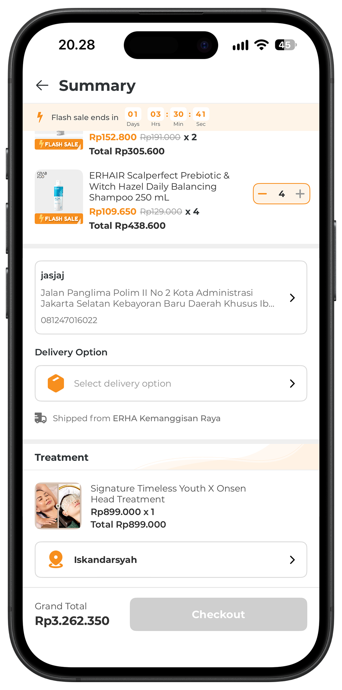

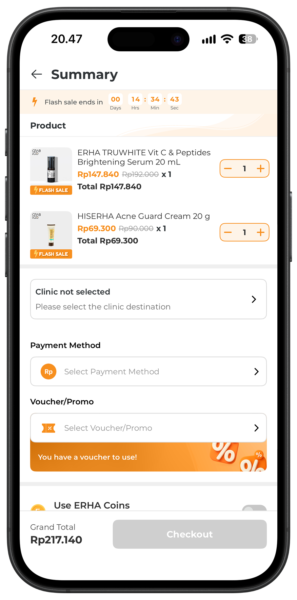

## Home revamp: implementing the updated screen

I implemented the updated Home screen design across the search area, menu grid, membership information, voucher and ERHA Coins sections, Best Seller banners, Flash Sale entry points, and bottom navigation.

The work included layout and asset updates, API-response mapping, and loading, empty, and error states. I also resolved differences between guest and authenticated layouts, clipped menu labels, inconsistent banner presentation, and sections that appeared incorrectly when their data was unavailable.

My contribution focused on translating the supplied design into the existing app structure and handling the states beyond the populated design mockup.

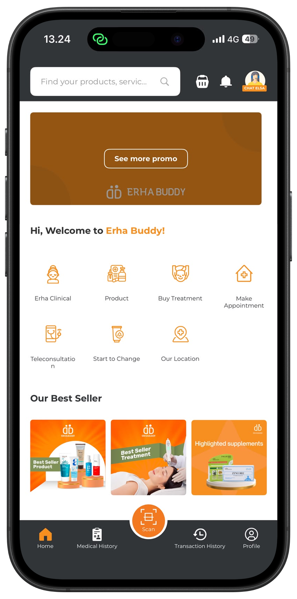

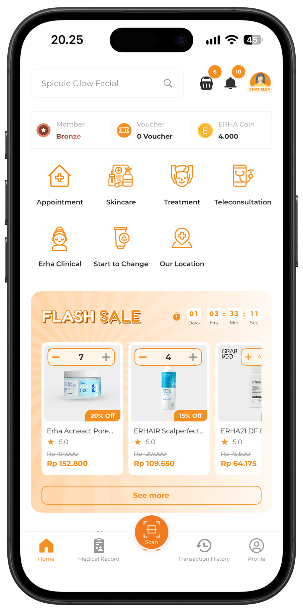

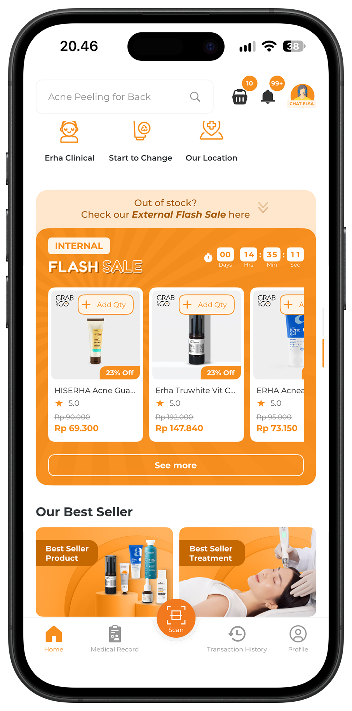

## Referral: translating the design into iOS screens

I implemented the Referral interface and its navigation within the existing membership and account flows. This included the referral guide, personal-code display, copy and share actions, referral-code input, and referred-user lists with Registered and Success states.

I added keyboard handling, scrollable layouts, loading skeletons, pull-to-refresh, and state-dependent feedback. My scope covered UI implementation and integration with the existing referral behavior.

I also corrected the date used for referral transaction display and sorting to reflect the user's registration time.

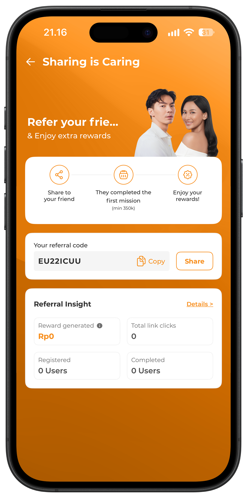

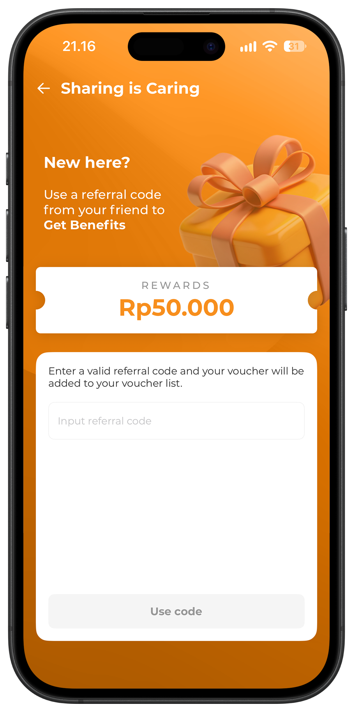

