Paintee helps beginners create proportional and symmetrical face painting. I approached it as a face-aware AR experience built from first principles.

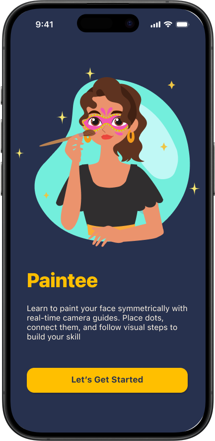

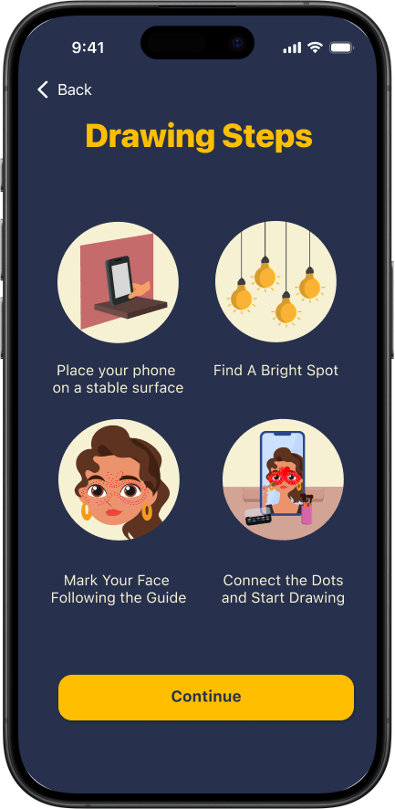

## The problem: proportion and symmetry

Beginners applying face painting to their own faces often struggle with proportion and symmetry, especially when working from references on a flat surface.

From a builder's perspective, the problem was how to design an experience that understands facial structure and guides precision in real time.

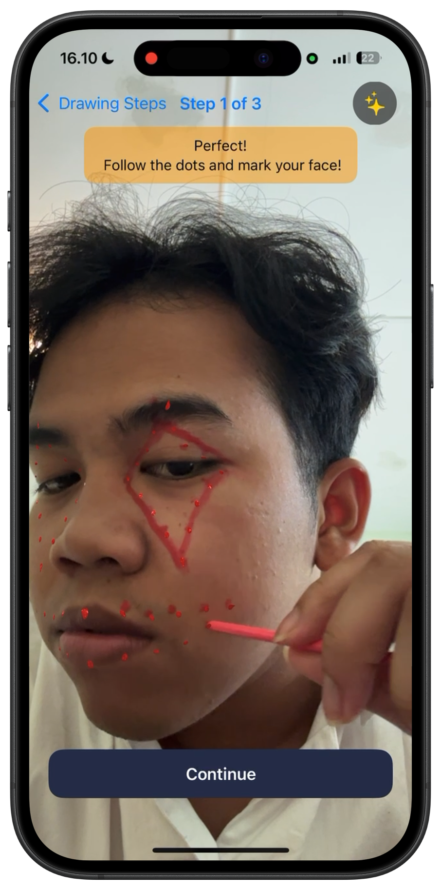

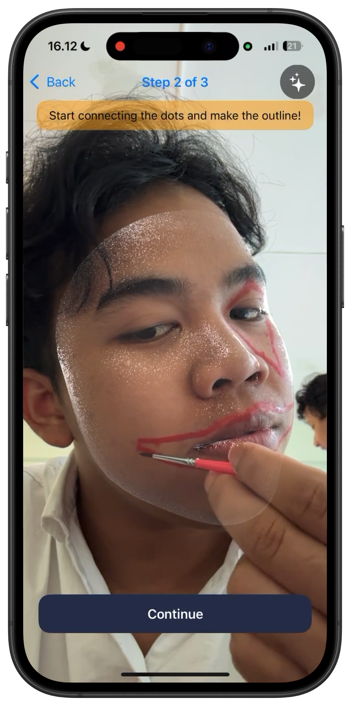

## Navigation around a continuous AR session

Face painting is a continuous, hands-on activity. Every interruption can break focus, muscle memory, and spatial alignment.

In Paintee, navigation respects the session itself. The app preserves a **single, continuous AR session** while guiding users through structured phases: previewing, dotting, outlining, and painting.

Screens change while the session remains active. This turns navigation into session control, allowing beginners to stay grounded in the same physical space while progressing with confidence and precision.

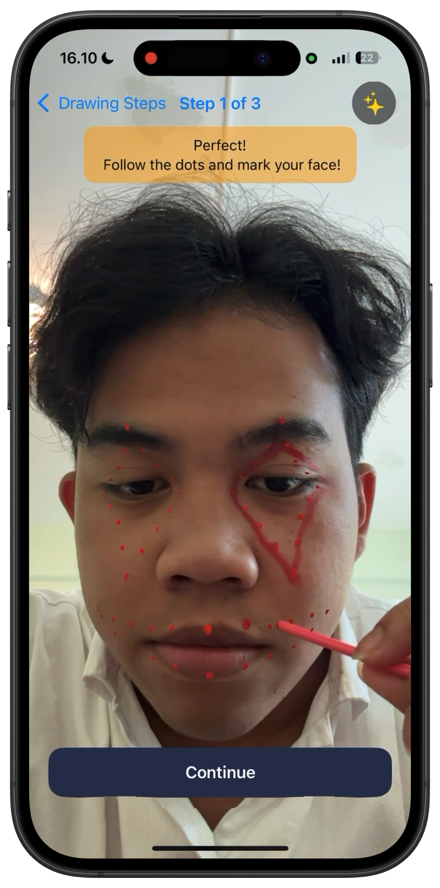

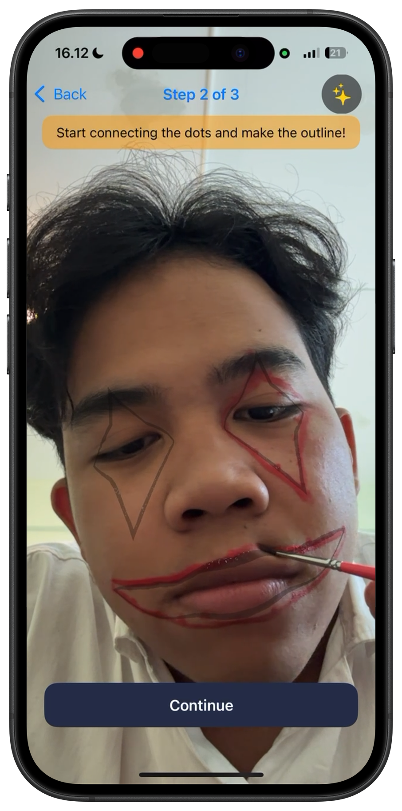

## Voice control as a primary interaction

During face painting, hands are already busy and attention is split between a mirror, the brush, and facial precision. Asking users to tap buttons or navigate the UI breaks focus at the moment it matters most.

Voice control lets users move between steps, toggle guidance, and progress through the experience without unnecessary touch interactions. They can stay focused on applying the paint, keeping their hands, posture, and attention anchored to the task.

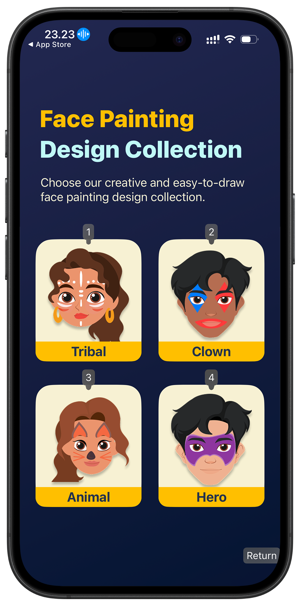

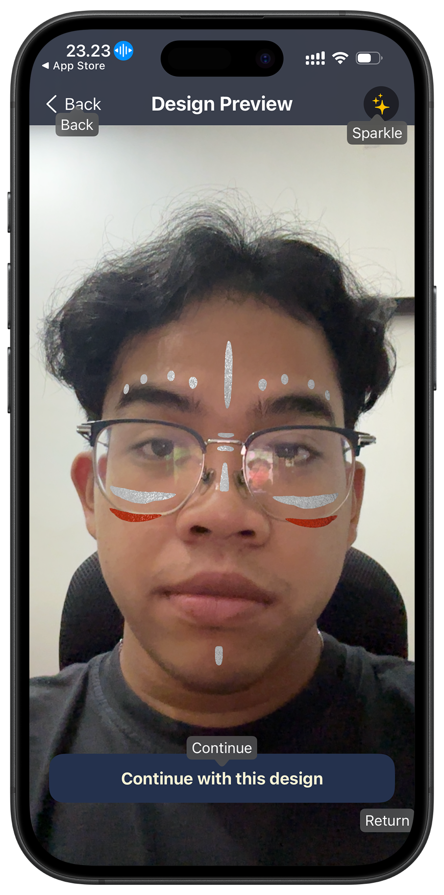

## A focused application flow

Paintee is structured as a single, linear session. From design preview to guided application and finally capturing the result, each step advances the same underlying state instead of creating a new context.

The AR session stays alive while the UI layers shift just enough to guide the next action. This keeps navigation lightweight and predictable, avoids unnecessary resets, and preserves spatial alignment throughout the process.

Treating the experience as one continuous flow removes interface friction and lets users focus on the physical act of face painting.

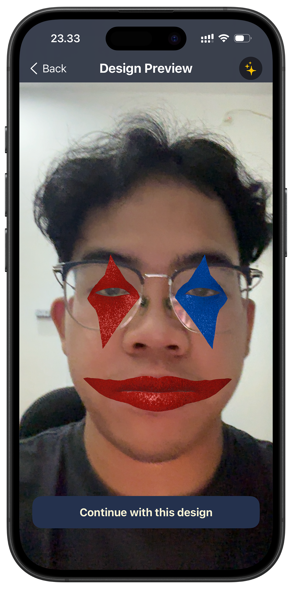

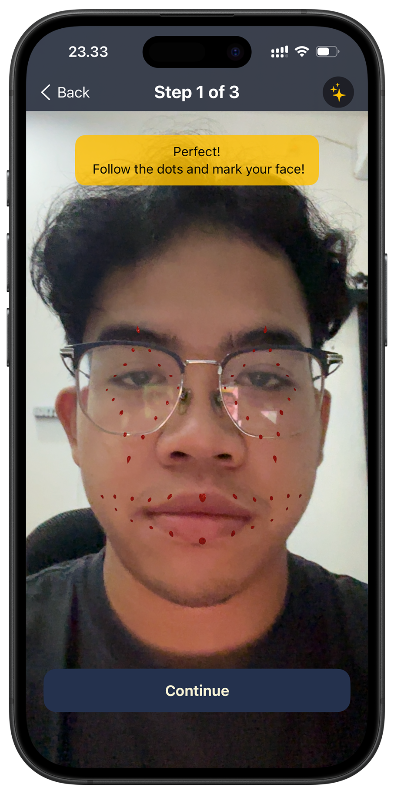

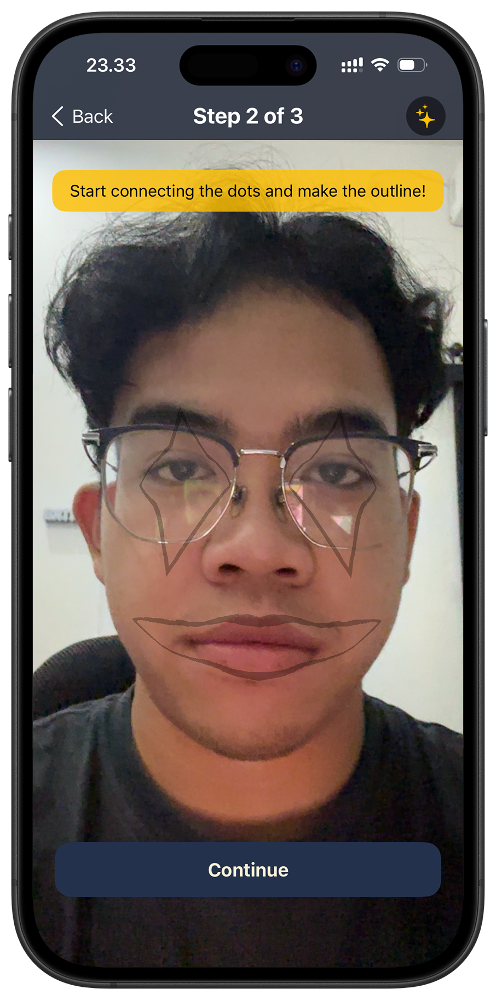

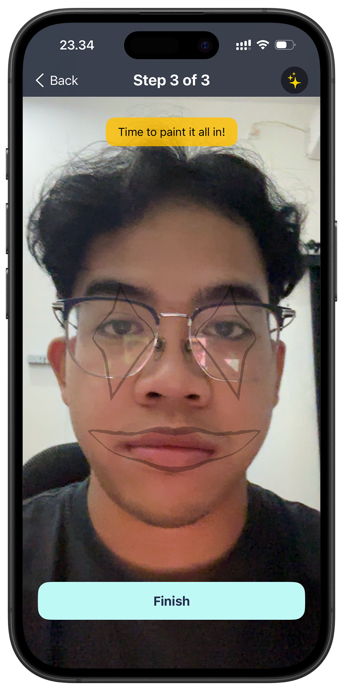

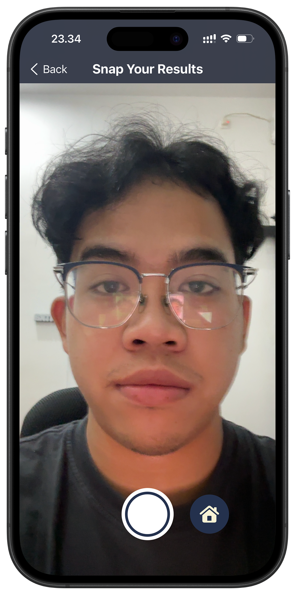

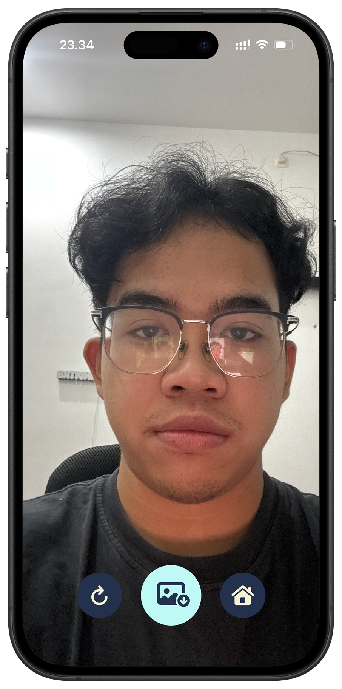

## Technology stack

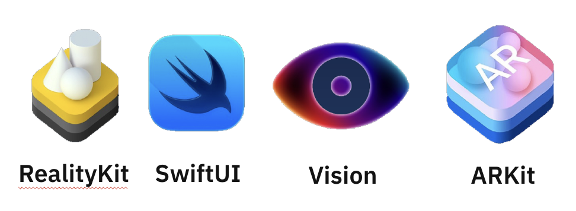

- RealityKit
- SwiftUI
- Vision
- ARKit

## App Store release

The portfolio records Paintee's App Store release and its face painting design collection. The collection provides creative, easy-to-draw designs for users to choose before guided application.
