Rooted DBT makes DBT skills simple, daily, and doable. My contribution focused on developing learning flows and the engineering structure behind dynamic lesson content.

## Routing dynamic content

In the Mindfulness lesson module, I implemented a routing structure to support highly dynamic lesson content without coupling navigation logic to individual views.

I separated routing logic from presentation. Navigation between lesson steps was driven by a centralized routing layer instead of view-specific state changes.

This allowed lessons to progress linearly or conditionally without duplicating navigation code across screens. It provided a clearer mental model and made maintenance easier as lesson structures evolved.

<div class="project-screens" role="group" aria-label="Dynamic mindfulness lesson content" tabindex="0">

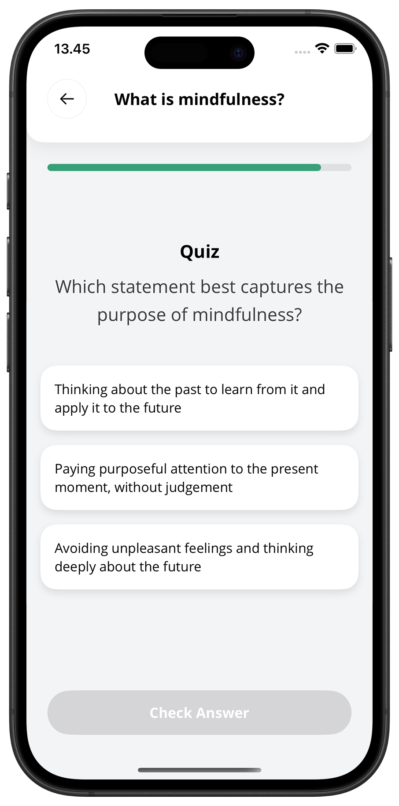

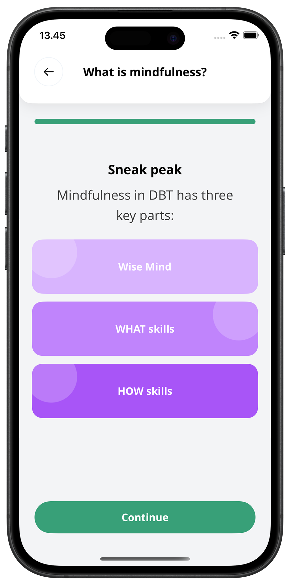

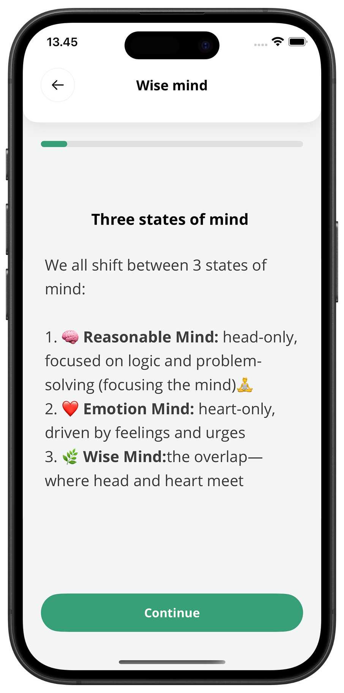

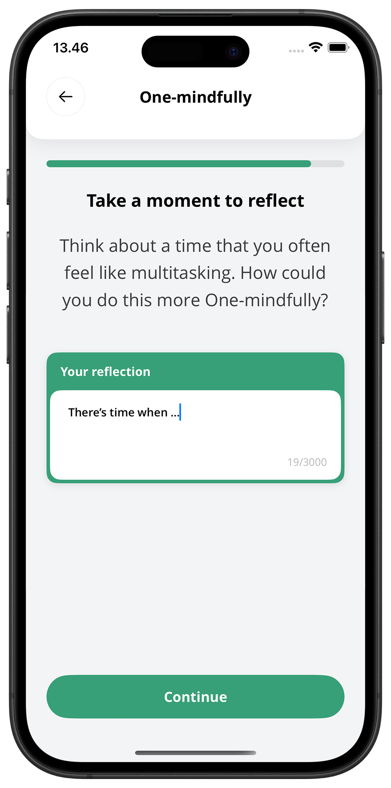

</div>

## Generics for flexible lesson content

I designed lesson sections and items as generic data structures constrained by the `LessonContent` and `LessonRoute` protocols.

This made it possible to reuse the same `LessonItemCellView` across multiple lesson configurations while keeping routing explicit and type-safe. New lesson variations could be introduced by defining new content and routes, without modifying the core component or navigation flow.

The portfolio shows the same component configured for mindfulness and distress tolerance lessons:

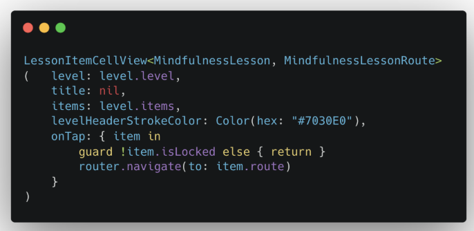

```swift
LessonItemCellView<MindfulnessLesson, MindfulnessLessonRoute>(
    level: level.level,
    title: nil,
    items: level.items,
    levelHeaderStrokeColor: Color(hex: "#7030E0"),
    onTap: { item in
        guard !item.isLocked else { return }
        router.navigate(to: item.route)
    }
)
```

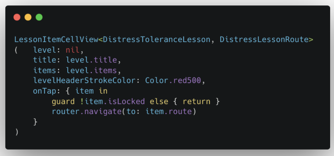

```swift
LessonItemCellView<DistressToleranceLesson, DistressLessonRoute>(
    level: nil,
    title: level.title,
    items: level.items,
    levelHeaderStrokeColor: Color.red500,
    onTap: { item in
        guard !item.isLocked else { return }
        router.navigate(to: item.route)
    }
)
```

These are usage examples from the portfolio; the types and surrounding application code are defined in the original project.

<div class="project-screens" role="group" aria-label="Mindfulness and distress tolerance lesson components" tabindex="0">

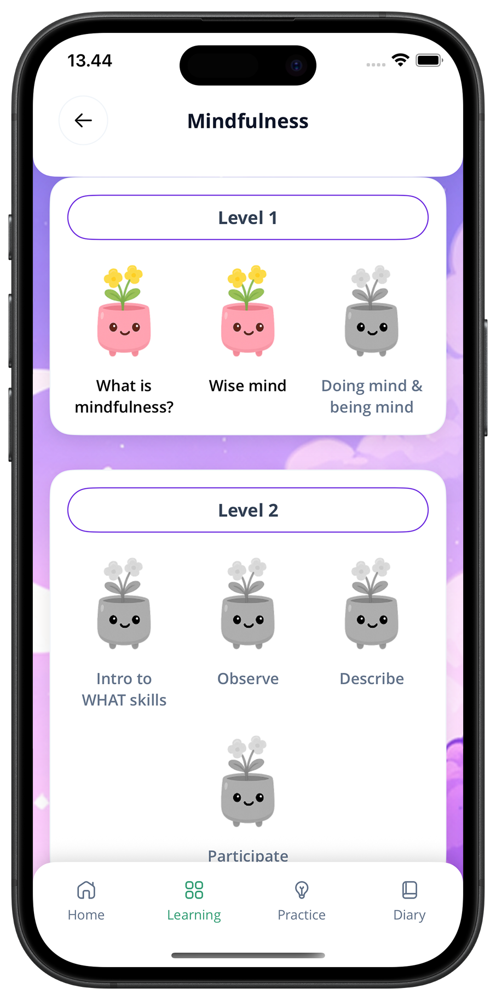

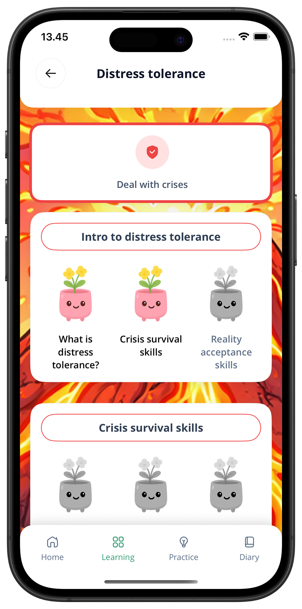

</div>

## Reusing views with minimal configuration

With the generic structures in place, multiple lesson views can be implemented with a small amount of configuration code. Content and routes change while the shared component and navigation flow stay consistent.

<div class="project-screens" role="group" aria-label="Reusable DBT learning modules" tabindex="0">

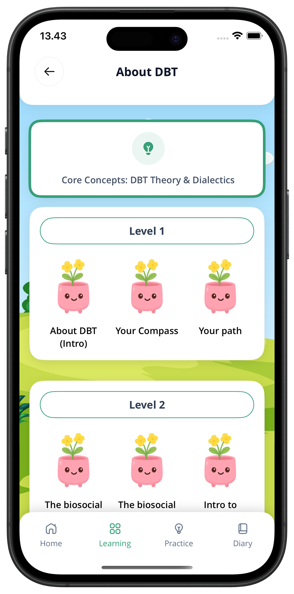

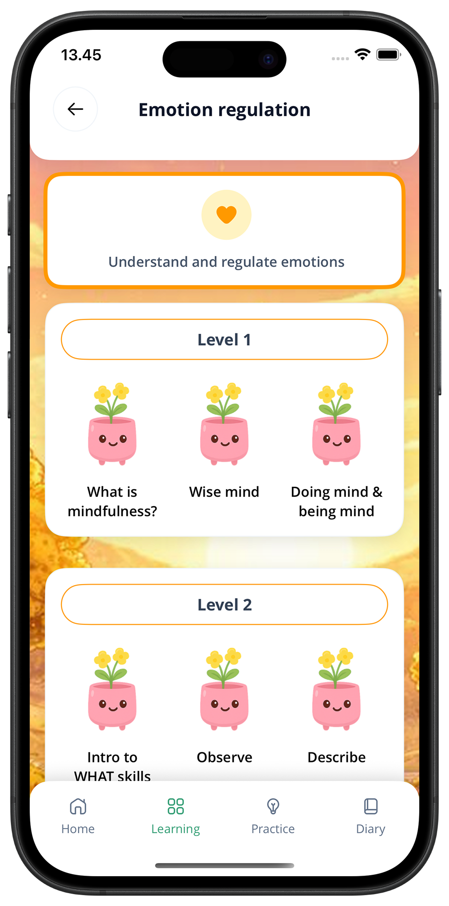

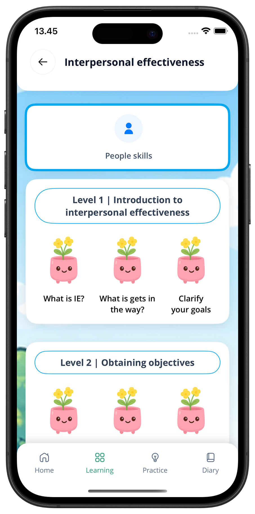

</div>

## Key learnings

This project deepened my understanding of how engineering decisions affect user focus in mindfulness experiences. Clean routing, reusable components, and minimal UI friction were product constraints as well as technical choices.

I learned to balance flexibility with simplicity, allowing the system to grow without exposing complexity to the user. Contributing through **small, well-scoped changes** also reinforced the value of iteration over large, disruptive rewrites in a shared codebase.
