SLNG helps foreign students understand informal Indonesian. I built it as a fast, native, playful app, focusing on how people encounter slang in everyday conversations.

## The problem: meaning and social context

Foreign students struggle to understand the meaning and social context of Indonesian slang. Slang evolves quickly, which makes it hard to keep up.

From a developer's perspective, the interesting problem was how to design an iOS experience that handles unpredictable, fast-moving language gracefully.

Many foreign students could recognize a slang word without understanding the intention behind it. Meaning shifts with tone, sentiment, and social context. One word can change entirely depending on how it is used.

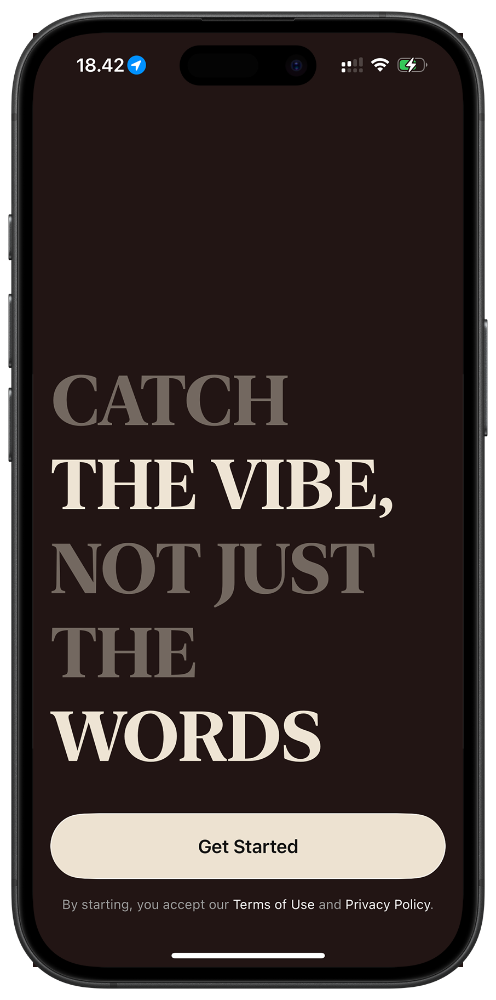

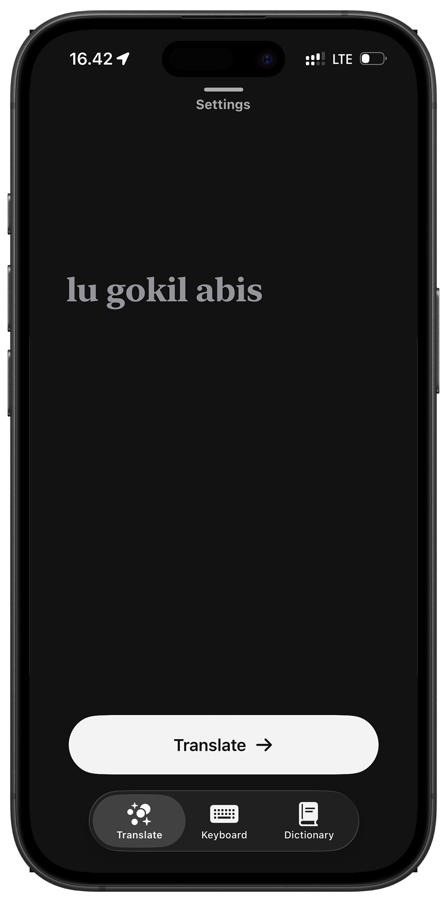

## Modeling nuance

I built SLNG's data model to capture that nuance. Each slang entry has contextual variants, sentiment labels, and bilingual examples, paired with a matching algorithm that handles spelling variations and tone alignment.

This lets SLNG detect the slang and its meaning in that moment, making translations more intuitive.

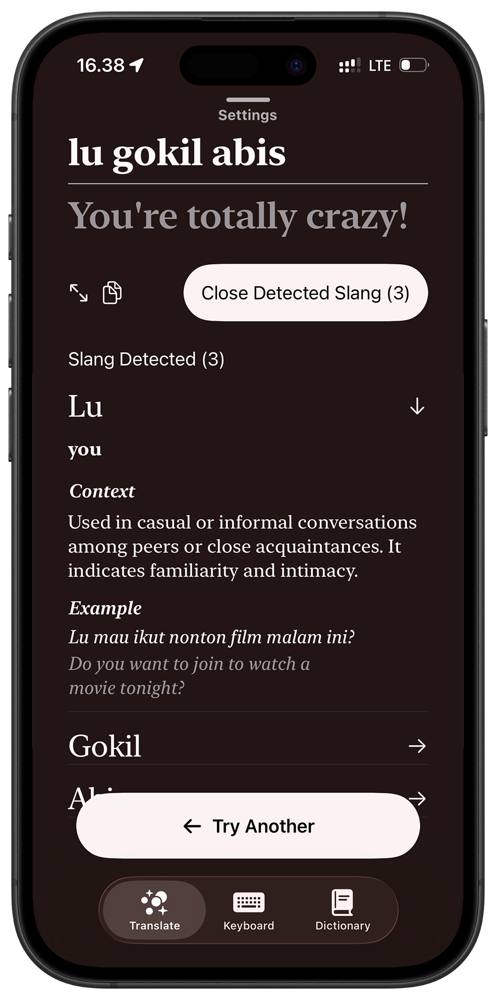

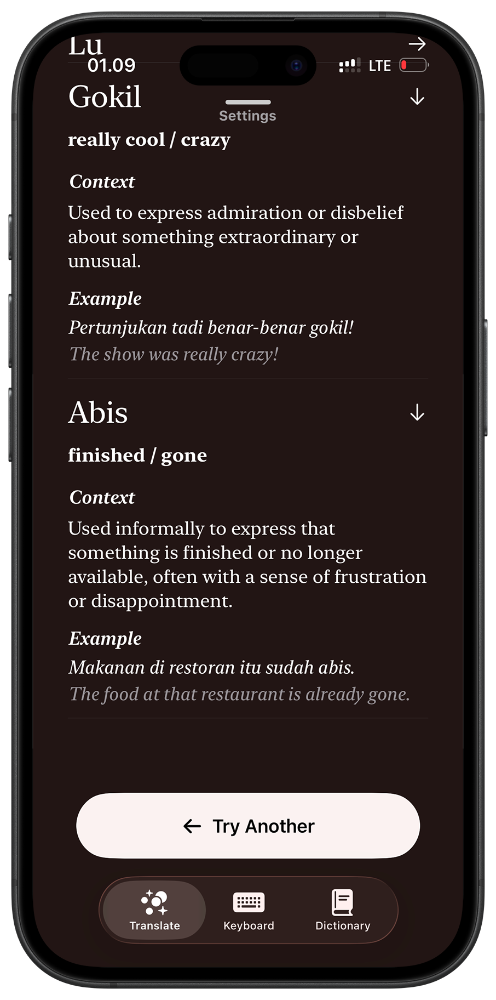

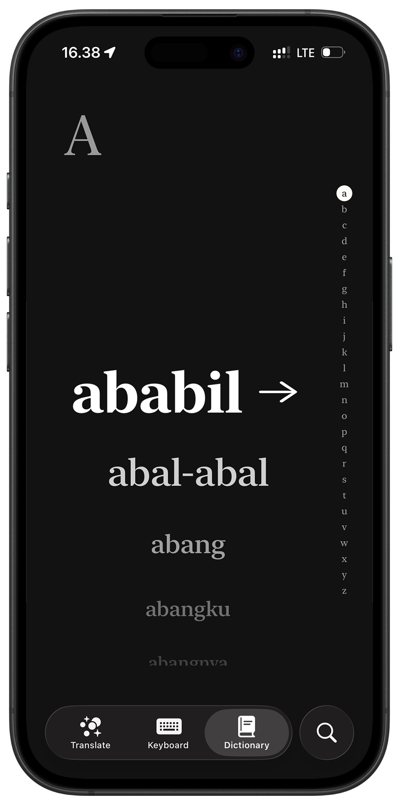

## Features for real conversations

I focused on what helps users interpret meaning in real conversations. SLNG is built around multiple entry points: the main app, a custom keyboard, and a system-wide Share Extension. Users can understand slang wherever it appears.

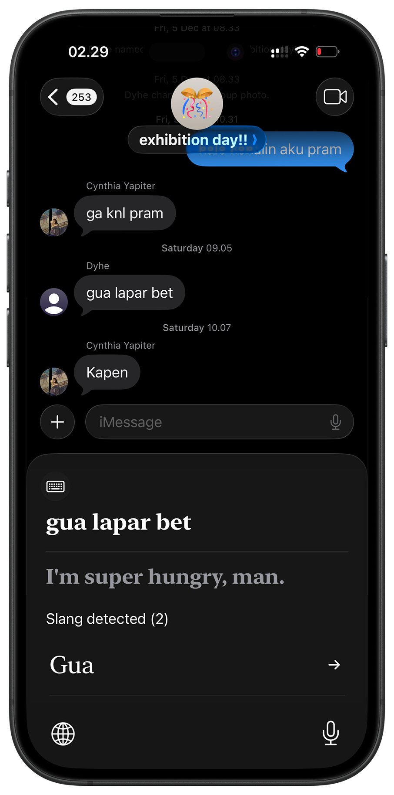

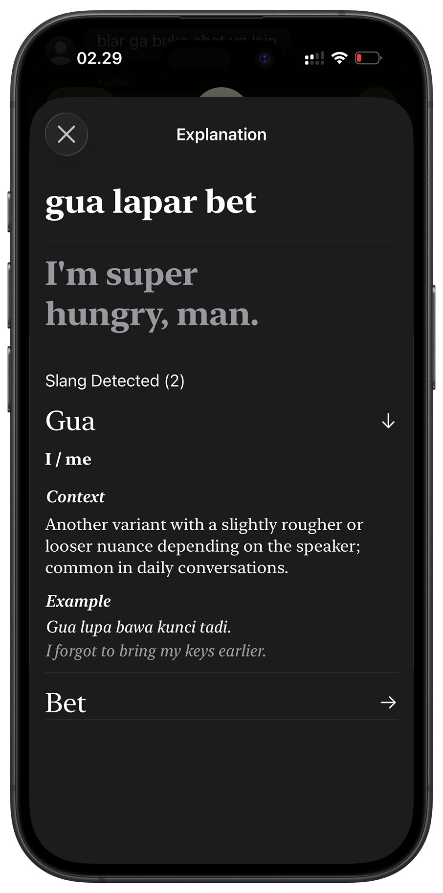

## Motion, sound, and haptics

SLNG needed a personality that felt more expressive than a static dictionary. I shaped the experience with motion, sound, and haptics to match the lively nature of slang.

Interactions use fluid spring animations, subtle haptic cues, and light audio touches that make actions feel tactile without becoming gimmicky. The interactions follow iOS-native principles: responsive, intentional, and lightweight. My goal was an expressive experience that was fun to use without introducing visual noise.

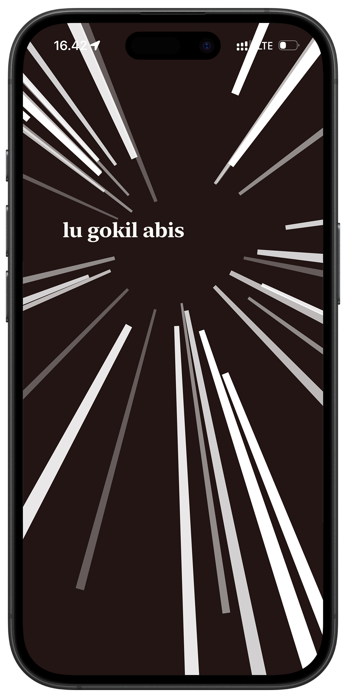

## Iterating from real feedback

SLNG evolved through fast iterations shaped by real user behavior. Testers noted minor inconsistencies in gestures and transitions.

A key insight came from foreign students who often heard slang without knowing how to spell it. This led to the addition of **Speech-to-Text** and a refined input flow for real-world voice conversations.

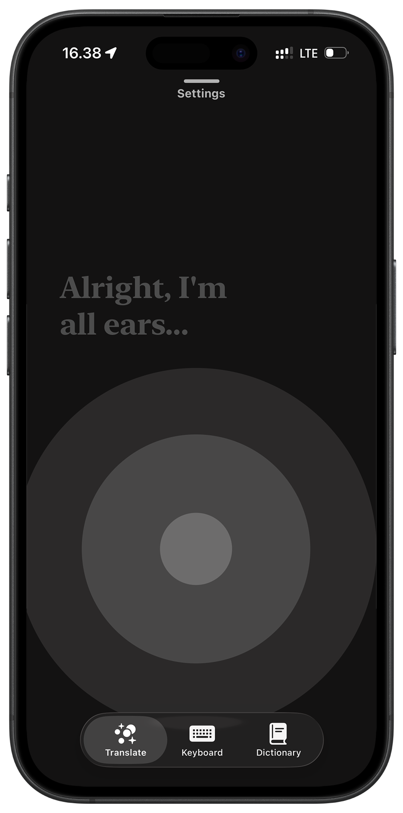

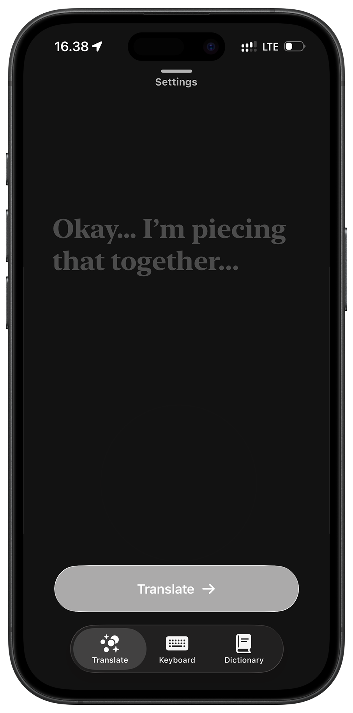

## Rebuilding the backend in Go

As usage scaled, backend latency became a bottleneck. The initial Node.js prototype worked for early validation, but it struggled with consistent response times under concurrency.

I rebuilt the backend in Go. The migration enabled lightweight routing, stronger concurrency handling, and more efficient memory usage. Average response times dropped from approximately **3 seconds to 1.5 seconds**, cutting latency in half.

The faster backend translated into a more fluid, responsive, and reliable user experience.

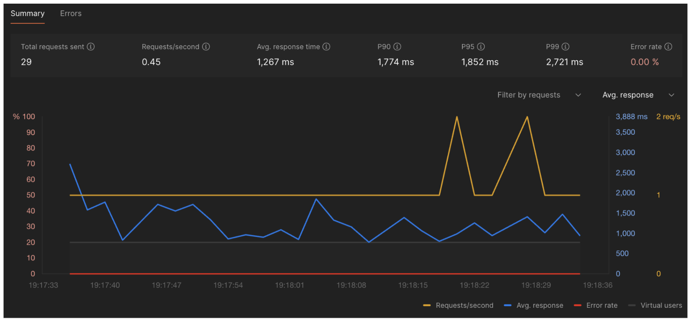

## Tracing feature usage

I used Firebase Analytics to trace which features users actively engaged with. Feature-level usage data showed where users found value, helping me prioritize iterations and focus development effort on the areas that mattered most.

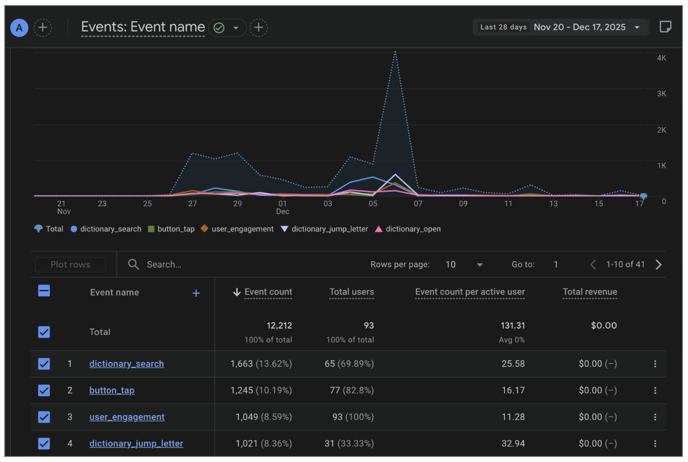

## Technology stack

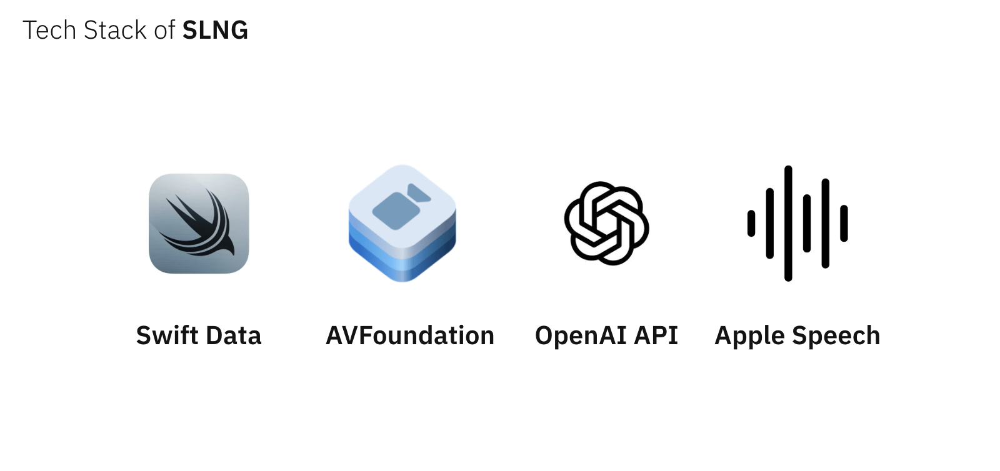

- SwiftData
- AVFoundation
- OpenAI API
- Apple Speech

The backend migration used Go, and feature usage was measured with Firebase Analytics.

## App Store metrics

The portfolio includes the following App Store Connect snapshot for **September 24 to December 22**. The year is not displayed in the screenshot. These are historical figures from the portfolio, rather than live metrics.

| Metric | Recorded value | Scope |
| --- | --- | --- |
| Impressions | 1.25K | Selected period |
| Product page views | 584 | Selected period |
| Conversion rate | 21.4% | Daily average |
| Total downloads | 117 | Selected period |
| Proceeds | $0 | Selected period |
| Proceeds per paying user | $0 | Daily average |
| Sessions per active device | 3.02 | Daily average; Opt-in only |
| Crashes | 1 | Opt-in only |

The snapshot displays a 0% comparison beside each overview metric. Average retention is marked **Not enough data**, with an opt-in-only scope.

### Downloads by territory

These are the territory rows visible in the portfolio screenshot; they do not account for every download in the total.

| Territory | Downloads |
| --- | --- |
| Indonesia | 109 |
| Taiwan | 2 |
| United States | 2 |
| Australia | 1 |
| Japan | 1 |

### Downloads by source

| Source | Share | Downloads |
| --- | --- | --- |
| App Store Search | 64.1% | 75 |
| App Referrer | 29.1% | 34 |
| App Store Browse | 3.4% | 4 |
| Web Referrer | 2.6% | 3 |
| Unavailable | 0.9% | 1 |

### Downloads by device

| Device | Share | Downloads |
| --- | --- | --- |
| iPhone | 98.3% | 115 |
| iPad | 0.9% | 1 |
| Desktop | 0.9% | 1 |

## App Store release

The portfolio records SLNG's App Store release as an Indonesian slang translator. Its presentation describes the product with the phrase “Catch the vibe, not just the words,” alongside translation, keyboard, and dictionary screens.
